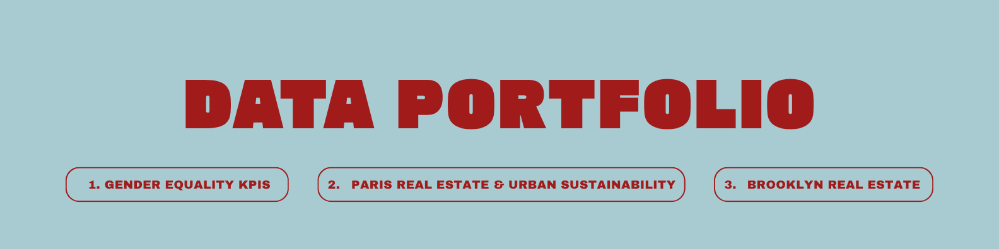

# Salomé Rolland - Data Analyst

**Contact**

[LinkedIn](https://www.linkedin.com/in/salomé-rolland-4b8888425/) · [rollandsalome@gmail.com](mailto:rollandsalome@gmail.com)

Bringing data and behavioral science together to drive better decisions

**Toolbox**

---

## Projects

| # | Project | Stack | Focus |
|---|---------|-------|-------|
| 01 | [Gender Equality KPIs](#1-gender-equality-kpis) | SQL · Power BI | Workplace Gender Inequalities in the EU |
| 02 | [Paris Real Estate & Urban Sustainability](#2-paris-real-estate--urban-sustainability) | Python · SQL · Power BI | Real Estate Sales Analysis & Urban Sustainability Distribution |
| 03 | [Brooklyn Real Estate](#3-brooklyn-real-estate) | SQL · Tableau | Property Sales Analysis |

All three projects are built on **open, public data**, so every result is fully reproducible.

---

# ‣ 1. Gender Equality KPIs Project

**⬇ Power BI file:** [Dashboard_Gender_Equality.pbix](Project_1_Gender_Equality_SR.pbix)

## Context
Analysis of gender equality in the workplace across the 27 EU member states, based on open data from Eurostat's Sustainable Development Goals dataset (https://ec.europa.eu/eurostat/web/sdi/database). The project covers the full data pipeline: extracting and cleaning the data in Power Query, star schema modeling (one fact table, three dimensions) and building an interactive Power BI dashboard based on several custom KPIs of gender equality.

## Research question
How significant is the workplace gender equality gap across the EU countries ?
- Which areas of gender equality should be prioritized ?
- Which countries lead or lag ?

## - ETL - Dimensional Modeling - Data Vizualization -

### Dimensional Modeling in Power BI

Star Schema composed of :
- Fact table: FACT_Indicators_Gender_Equality
- Dimension tables: DIM_Date, DIM_Country & DIM_Indicator

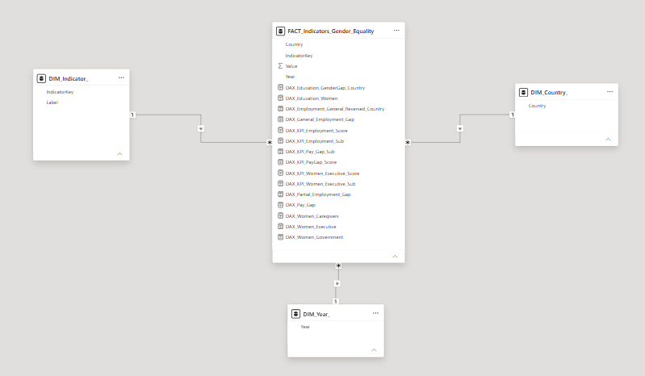

### Visualization & Analysis of Data in Power BI

#### Insights

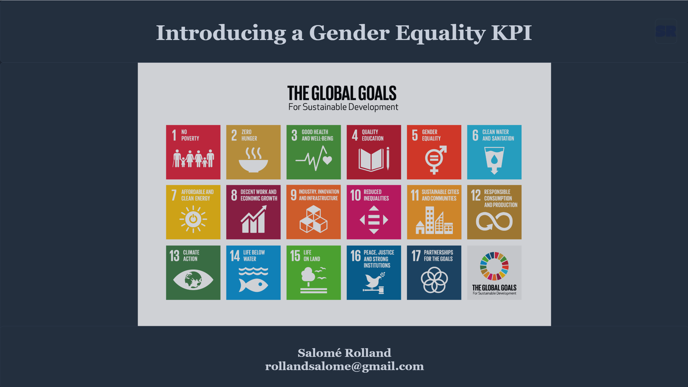

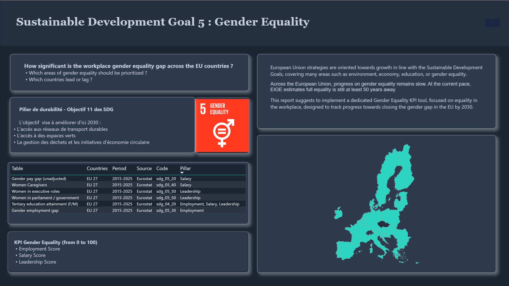

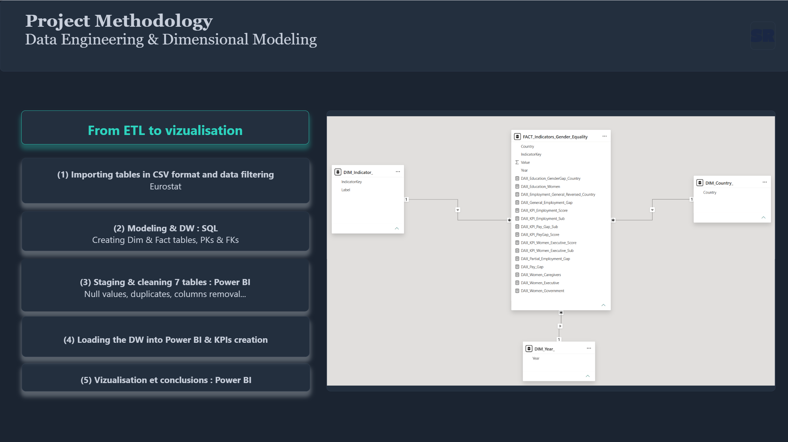

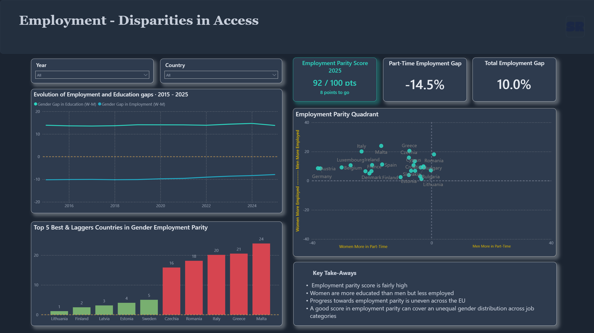

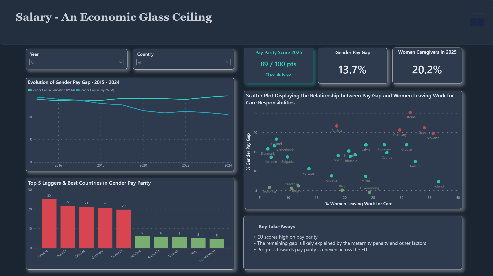

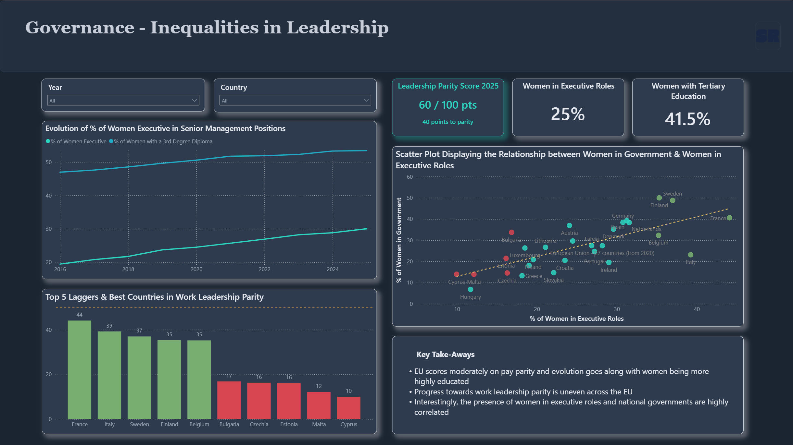

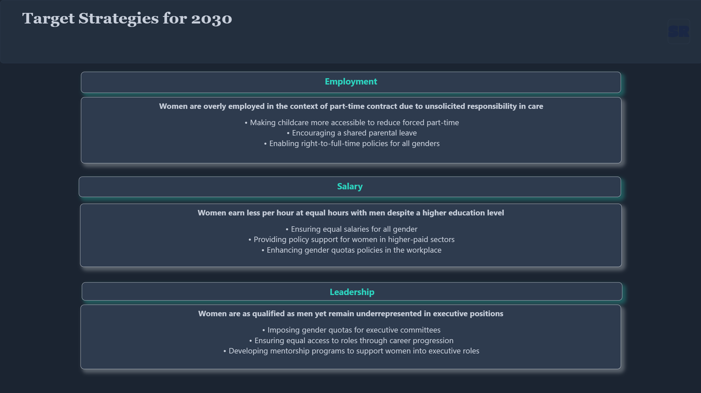

# ‣ 2. Paris Real Estate & Urban Sustainability

**⬇ Power BI file:** [Dashboard_Paris_Sustainability.pbix](Project_2_Paris_Sustainability_SR.pbix)

## Context
Analysis of the Paris housing market through the lens of urban sustainability, aimed at locating areas that combine investment potential with sustainable living across the city's arrondissements and neighbourhoods. 
The project is mainly built on open data from the City of Paris (Paris Open Data) or French Open Data.
The project covers the full data analytics pipeline: extracting and cleaning the data in Power Query, dimensional modeling, and building an interactive Power BI dashboard.

## Research question
Which areas of Paris concentrate investment opportunities that are both sustainable and profitable?
- Where are the best real-estate investment opportunities located across Paris?
- Are the most sustainable arrondissements also the most expensive?

## - ETL - Dimensional Modeling - Data Vizualization -

### Dimensional Modeling in Power BI

- Snowflake schema compossed of
  - Fact tables: FACT_Transaction (property sales), FACT_Loyer (rents), FACT_Equipement (sustainable amenities)
  - Dimensions tables: DIM_Geo (arrondissement & IRIS), DIM_quartier, DIM_Date, DIM_Bien (property type)

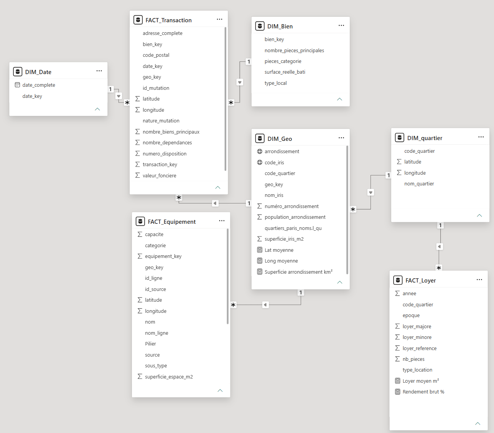

### Visualization & Analysis of Data in Power BI

#### Insights

# ‣ 3. Brooklyn Real Estate

Analysis of the residential property sales in Brooklyn, based on open data from the NYC Department of Finance (https://www.nyc.gov/site/finance/property/property-rolling-sales-data.page). The project covers the full data pipeline: extracting & cleaning the files in SQL Server, star schema modeling (one fact table, three dimensions), then analyzing the data and building an interactive Tableau dashboard.

Core research question: what is the median price per neighborhood, and how do prices vary across space and time?

## - ETL - Dimensional Modeling - Data Vizualization -

### Dimensional Modeling on Draw DB

- Star Schema composed of FACT_Sales, DIM_Date, DIM_Geo & DIM_Attributes

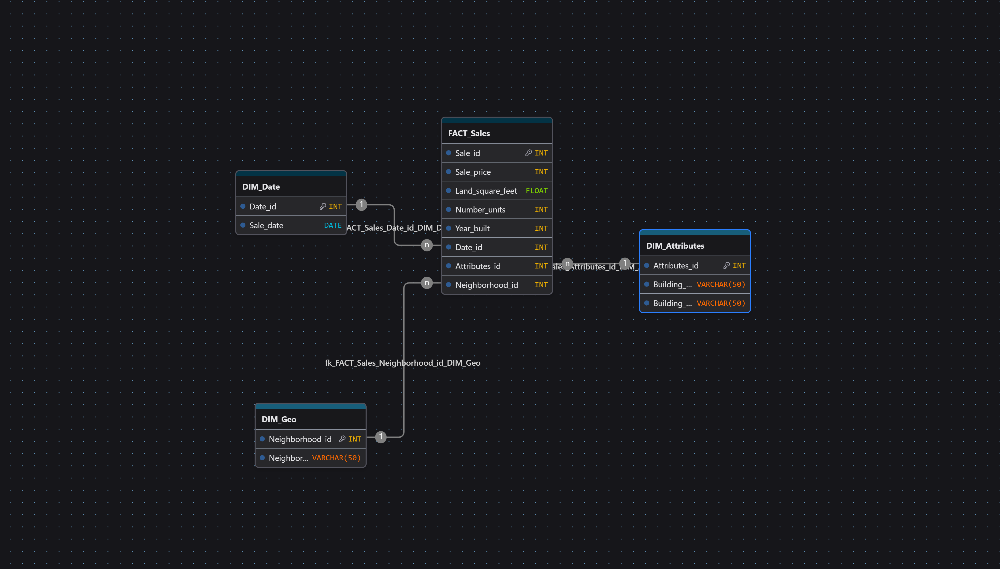

### ETL Process & primary analyses on SQL Server Management Studio

[Full script available here](Rolling_Sales.sql)

### Visualization & Analysis of Data on Tableau Public

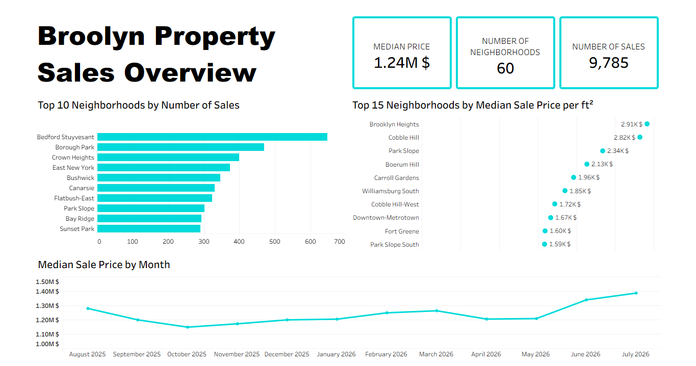

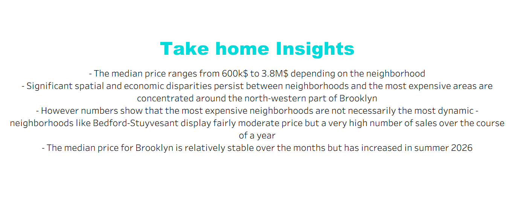

